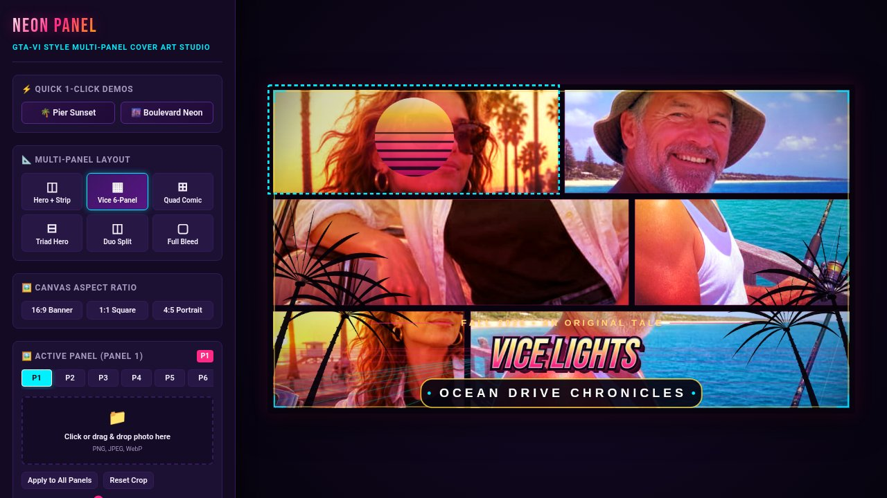

# Neon Panel — GTA 6 Style Multi-Panel Cover Art Studio

[](https://make.fun/bounty/gta6-cover-art-01)
[](https://make.fun/bounty/gta6-cover-art-01)
[](https://make.fun/bounty/gta6-cover-art-01)

**Neon Panel** is a pure browser-based, offline cover art maker inspired by the iconic multi-panel box art and sunset aesthetic of Vice City. It lets you load any local photo, slice it across authentic comic panel layouts, independently crop, pan, and zoom each panel, apply Vice City color grading and original vector overlays, letter high-impact 3D titles, and export clean high-resolution PNG posters in standard aspect ratios.

---

## ✨ Features

- **Multi-Panel Comic Layouts**: Choose from 6 versatile multi-panel layouts:
  - **Vice 6-Panel (`classic-6`)**: The authentic multi-character box art layout.
  - **Hero + Strip (`hero-strip`)**: Wide primary focal hero on the left with 3 stacked action panels on the right.
  - **Quad Comic (`grid-4`)**: Balanced 2x2 grid.
  - **Triad Hero (`triad-3`)**: Upper cinematic hero with split bottom panels.
  - **Duo Split (`split-2`)**: Dual character confrontation split.
  - **Full Bleed (`solo-1`)**: Single photo full canvas composition.
- **Interactive Crop, Pan & Zoom**: Click or drag directly on the canvas to reposition photos within any panel; use sliders or the mouse wheel to fine-tune focal points.
- **Vice City Color Grades**: Atmospheric grading washes with real-time gradient mapping:
  - *Vice Sunset* (golden warmth, tropical magenta, deep purple)
  - *Neon Pink / Cyan* (high-contrast synthwave grade)
  - *Dusk Horizon* (moody twilight indigo and peach)
  - *Noon Haze* (scorching midday sun warmth)
- **Original Vector Overlays**: Toggle procedural retro vector decorations:
  - Segmented Retrowave Sunset Sun
  - Silhouette Coconut Palms
  - Perspective Horizon Floor Grid
  - Film Grain texture & Cinematic Vignette
  - Letterbox Bars & Comic Seam Pinstripe Borders
- **Impact Typography Engine**:
  - High-impact display lettering with multi-pass 3D extruded drop shadows, glowing neon auras, and gradient fills.
  - Vendored SIL Open Font License display fonts (`Bebas Neue`, `Anton`, `Archivo Black`).
  - Dark subtitle pill badge with gold border and tracking.
  - Teaser tagline flanked by accent neon rules.
  - Non-overlapping layout with automatic size adjustment.
- **High-Res PNG Export**:
  - **1080 × 1080** — Square poster (1:1 feed)
  - **1080 × 1350** — Portrait poster (4:5 story/box art)
  - **1920 × 1080** — Landscape banner (16:9 wallpaper/header)
- **100% Offline & Private**: Zero build steps, zero npm dependencies, zero network requests or external CDNs. All processing and rendering happen locally on HTML5 Canvas.

---

## 🚀 Getting Started

Serve locally with Node (built-in standard library, Node 22):

```bash
node serve.ts
```

Then open your browser to:
[http://localhost:8080](http://localhost:8080)

To specify a custom port:
```bash
node serve.ts --port 3000
```

---

## 📷 Screenshots

| Showcase Cover (1:1 Square) | Studio Editor | Portrait Story (4:5 Poster) |
|:---:|:---:|:---:|
|  |  |  |

---

## 🎨 Design, Assets & License

- **Original Design**: Neon Panel is an original independent design inspired by tropical synthwave and retro game cover aesthetics. It contains no Rockstar Games logos, trademarks, copyrighted artwork, or proprietary GTA assets.
- **Typography**: Display fonts `Bebas Neue` (by Dharma Type), `Anton` (by Vernon Adams), and `Archivo Black` (by Omnibus-Type) are vendored under `app/fonts/` and licensed under the [SIL Open Font License 1.1](app/fonts/OFL.txt).
- **Sample Photos**: The sample photos under `app/samples/` (`pier.jpg`, `boulevard.jpg`) were generated with an image model for make.fun and are CC0 / royalty-free.
- **Source Code**: Released under the [MIT License](LICENSE).
