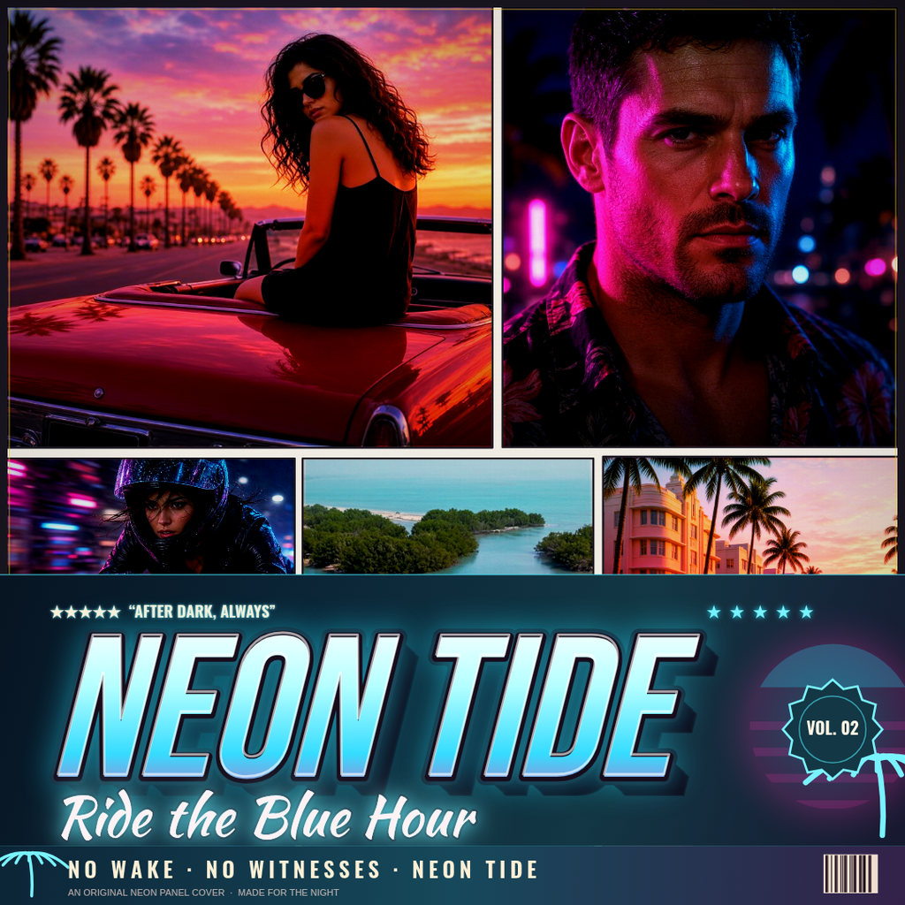

# Neon Panel — Cover Art Studio

[](https://make.fun/bounty/gta6-cover-art-01)
[](https://make.fun/bounty/gta6-cover-art-01)
[](https://make.fun/bounty/gta6-cover-art-01)

**Live demo (no install, works on desktop, tablet and phone):** [https://yunnaysy.github.io/neon-panel-cover-maker/](https://yunnaysy.github.io/neon-panel-cover-maker/)

### New in the live demo

- **Every photo stays visible:** lettering sits below the photos by default, with an optional see-through "over photos" mode.
- **Undo / redo** buttons plus Ctrl/Cmd+Z and Shift+Ctrl/Cmd+Z.
- **Lettering controls:** size, spacing, line height and position for title, subtitle and billing, drag on the poster, 9-position grid and auto-fit.
- **9 poster fonts and 6 one-tap lettering templates** (Classic Neon, Chrome Blockbuster, Neon Script Sign, Minimal Noir, Retro Arcade, Stacked Bold).
- **Colour grade scope:** apply a look to the entire poster or only the selected panel, with per-panel strength.
- **Tablet and phone layout** with the neon brand header and a bottom control sheet.

The previous version stays online at [/v2/](https://yunnaysy.github.io/neon-panel-cover-maker/v2/).

Neon Panel is a private-by-design poster maker inspired by sunlit coastal cities, neon nights and graphic crime-story cover art. Build a collage from local photos, reframe each panel, add custom lettering and export a high-resolution PNG. The app is static, dependency-free and works offline.

## Features

- **Five adaptive layouts:** Key Art (angled hero and five companion panels), Hero + Four, Mosaic Six, Split Diagonal and Full Bleed. Each adapts to landscape 16:9, portrait 4:5 and square 1:1 canvases.
- **Local photo editing:** Load a photo from your device, drop images onto individual panels, or click/drag a thumbnail from the sample library. Load sample cast fills the whole layout with distinct scenes. Pan and zoom with the canvas, sliders or wheel; reuse one photo across every panel when desired.
- **Five cinematic grades:** Golden Hour, Neon Night, Vice Dusk, Neon Haze and Pastel Deco, with adjustable strength, grade-matched poster colors, gentle vignette and print texture.
- **Original poster lettering:** Large auto-fit display title with a warm gradient, dark outline, dimensional shadow and glow; a neon script subtitle; quote and star-rating line; original starburst seal; and a sunset footer with palm, credits and a decorative barcode.
- **Three PNG exports:** 1920 × 1080 (16:9), 1080 × 1350 (4:5) and 1080 × 1080 (1:1).
- **Offline and private:** No network requests, uploads, build step or runtime dependencies. Your own photos remain in the browser on your device.

## Use it

Open the [live demo](https://yunnaysy.github.io/neon-panel-cover-maker/) in any modern browser. Nothing to install, and photos never leave your device.

### For developers

The app is static and dependency-free. To serve it yourself with Node.js 22 or newer, run `node serve.ts --port 8123`. To package the entry with the make.fun harness:

```bash
mkdir -p out
MAKEFUN_OUTPUT_DIR=out node main.ts
```

## Screenshots

The covers were exported as full-resolution PNGs through Neon Panel's own canvas export code, then downscaled without other edits. The editor screenshot shows the offline studio with the sample cast loaded.

| Landscape cover · 16:9 | Studio editor | Portrait cover · 4:5 | Square cover · 1:1 |
|:---:|:---:|:---:|:---:|
|  |  |  |  |

The exported cover PNGs were downscaled to 1280 × 720, 1024 × 1280 and 1024 × 1024. The editor was captured in Chrome at 1280 × 800.

## Fonts, images and license

The bundled **Bebas Neue**, **Kaushan Script**, **Pacifico** and **Oswald** fonts are distributed under the SIL Open Font License 1.1; the license and notices are in [`app/fonts/OFL.txt`](app/fonts/OFL.txt). The additional Anton and Archivo Black files are also OFL-licensed.

The seven added sample scenes were generated for this project and are released under CC0 1.0; see [`app/samples/CREDITS.txt`](app/samples/CREDITS.txt). The original `pier.jpg` and `boulevard.jpg` samples were generated with an image model for make.fun and are also free to use. The artwork is an independent design and contains no Rockstar Games logo, wordmark, game artwork or game character.

The app and entry code are released under the [MIT License](LICENSE).
