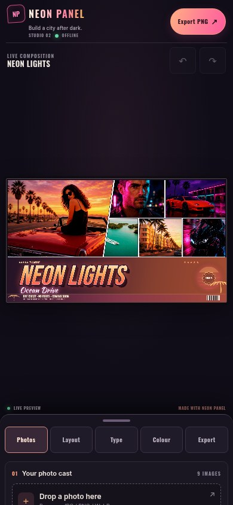

# Neon Panel — Cover Art Studio

Built for [make.fun](https://make.fun).

**Live demo (no install, works on desktop, tablet and phone):** [https://yunnaysy.github.io/neon-panel-cover-maker/](https://yunnaysy.github.io/neon-panel-cover-maker/)

Neon Panel is a private-by-design poster maker inspired by sunlit coastal cities, neon nights and graphic crime-story cover art. Build a collage from local photos, reframe each panel, add custom lettering and export a high-resolution PNG. The app is static, dependency-free and works offline.

## What's new

- **Golden Hour by default.** The studio opens on the v2 warm orange/peach look with the Classic Neon lettering template; Magenta Dusk remains available in the grade picker.
- **Photos always stay visible.** Lettering sits below the photos by default: every layout is reflowed into the area above the solid v2 title band, using the photo area's own aspect ratio. A second mode, *Lettering over photos*, uses the full canvas with a soft top-transparent scrim.
- **Undo / redo.** Snapshot history (photos kept by reference, capped at 80 steps), header buttons next to Export PNG, and Ctrl/Cmd+Z, Shift+Ctrl/Cmd+Z and Ctrl+Y. Shortcuts are ignored while typing in text fields.
- **Poster lettering + lettering size & position.** Card 04 holds the title, subtitle, quote, seal and tagline text fields. Card 05 holds placement, template cards and the Title/Subtitle/Billing controls: size, spacing, line-height, X/Y position, alignment, a 3 × 3 quick-position grid, auto-fit and font picker. Drag text on the poster to move it; drag the lavender corner handle to resize proportionally. The dashed outline appears only while hovering, dragging or editing lettering, and is preview-only.
- **Nine self-hosted poster fonts and six one-tap templates.** Classic Neon, Chrome Blockbuster, Neon Script Sign, Minimal Noir, Retro Arcade and Stacked Bold. Template cards render the real title band in each font, and applying one is a single undo step.
- **Colour-grade scope.** Apply a look to the *Entire poster* or only the *Selected panel*. The global grade is applied first, then the panel look is drawn on top. The panel highlight and preview-only PANEL label appear only in the Selected panel scope.
- **Tablet and phone layout.** A dedicated neon top bar with a three-line brand block, a poster that fits its container through `ResizeObserver`, and a fixed bottom control sheet that starts in a short peek state. Tapping a tab opens it to 55%, and the handle cycles peek → 55% → 88%. Photos, Layout, Type, Colour and Export tabs. No horizontal scrolling at any width.

## Features

- **Five adaptive layouts:** Key Art (angled hero and five companion panels), Hero + Four, Mosaic Six, Split Diagonal and Full Bleed. Each adapts to landscape 16:9, portrait 4:5 and square 1:1 canvases, and reflows above the lettering band by default.
- **Local photo editing:** Load a photo from your device, drop images onto individual panels, or click/drag a thumbnail from the sample library. Load sample cast fills the whole layout with distinct scenes. Pan and zoom with the canvas, sliders or wheel; reuse one photo across every panel when desired.
- **Five cinematic grades:** Golden Hour, Neon Night, Magenta Dusk, Neon Haze and Pastel Deco, with adjustable strength, grade-matched poster colours, gentle vignette and print texture. Local panel grades are included in export and history.
- **Original poster lettering:** A v2-faithful title band with a warm gradient display title, neon script subtitle, quote and star-rating line, starburst seal, sunset footer, palm, credits and decorative barcode. Lettering is measured in logical units (`u = sqrt(w*h)/1000`) so every export matches.
- **Lettering effects:** gradient, chrome, neon tube, flat and outline, plus automatic width and ink-height fitting so titles never hit the seal or leave the band.
- **Three PNG exports:** 1920 × 1080 (16:9), 1080 × 1350 (4:5) and 1080 × 1080 (1:1), after all fonts are loaded and ready.
- **Offline and private:** No network requests, uploads, build step or runtime dependencies. Your own photos remain in the browser on your device.

## Use it

Open the [live demo](https://yunnaysy.github.io/neon-panel-cover-maker/) in any modern browser. Nothing to install, and photos never leave your device.

### For developers

The app is static and dependency-free. To serve it yourself with Node.js 22 or newer, run `node serve.ts --port 8123`. To package the entry with the make.fun harness:

```bash
mkdir -p out
MAKEFUN_OUTPUT_DIR=out node main.ts
```

### Tests

The Playwright checks live in `tests/playwright.test.mjs`. They cover six viewports (1440×900, 1024×768, 768×1024, 640×1024, 390×844, 360×740), no horizontal scroll, zero console errors, Golden Hour as the default, hidden selection guides at load, hover-only lettering outlines, the mobile peek sheet, gradient Export PNG buttons, undo/redo never intersecting the poster, selected-panel grading, and PNG downloads. They also check all 15 layout × aspect BELOW combinations, all 90 template × layout × aspect combinations, and template undo:

```bash
python3 -m http.server 8130 --directory app &
node tests/playwright.test.mjs
```

## Screenshots

The covers were exported as full-resolution PNGs through Neon Panel's own canvas export code, then downscaled without other edits. The editor screenshot shows the current offline studio at 1440 × 900 with the sample cast loaded.

| Landscape cover · 16:9 | Studio editor | Portrait cover · 4:5 |
|:---:|:---:|:---:|
|  |  |  |

**Phone layout (390 × 844):**



## Fonts, images and licence

Nine OFL-licensed poster fonts are bundled in `app/fonts`: **Bebas Neue**, **Anton**, **Archivo Black**, **Monoton**, **Playfair Display**, **Kaushan Script**, **Pacifico**, **Oswald** and **Saira Stencil One**. The SIL Open Font License 1.1 and the copyright notices for every family are in [`app/fonts/OFL.txt`](app/fonts/OFL.txt).

The seven added sample scenes were generated for this project and are released under CC0 1.0; see [`app/samples/CREDITS.txt`](app/samples/CREDITS.txt). The original `pier.jpg` and `boulevard.jpg` samples were generated with an image model for make.fun and are also free to use. The artwork is an independent design and contains no game logos, wordmarks, artwork or characters.

The app and entry code are released under the [MIT License](LICENSE).
