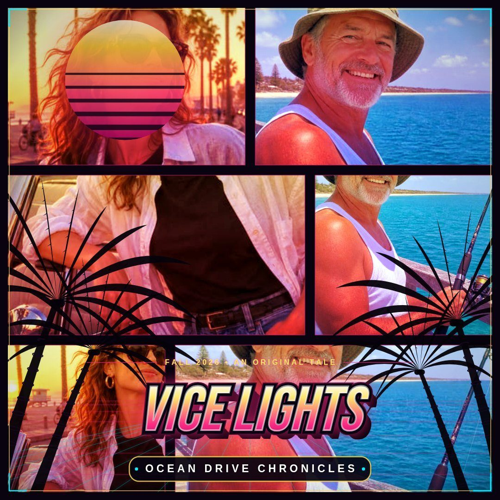
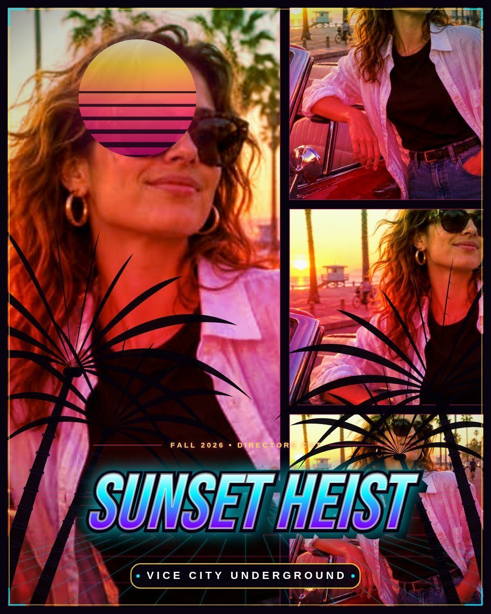
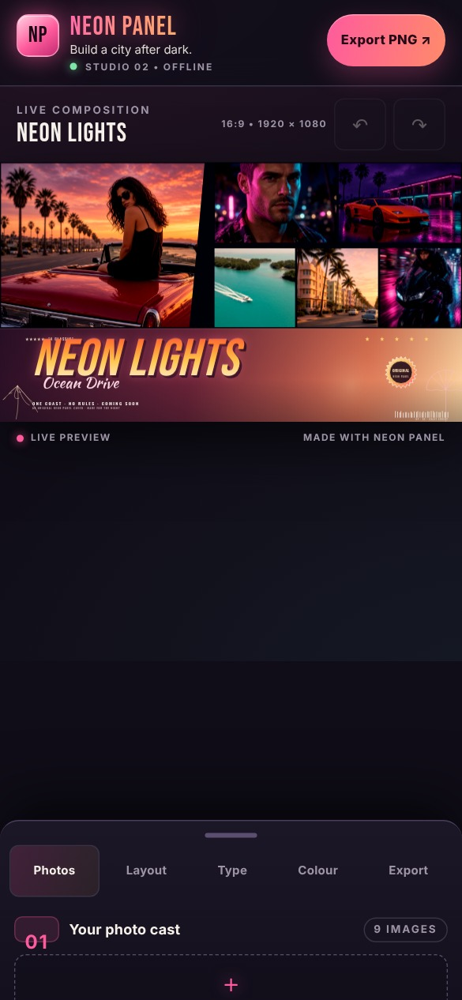

# Neon Panel — Cover Art Studio

[](https://make.fun/bounty/gta6-cover-art-01?utm_source=github&utm_medium=readme&utm_campaign=gta6-cover-art-01)
[](https://make.fun/bounty/gta6-cover-art-01/leaderboard?utm_source=github&utm_medium=readme&utm_campaign=gta6-cover-art-01)
[](https://make.fun/bounty/gta6-cover-art-01?utm_source=github&utm_medium=readme&utm_campaign=gta6-cover-art-01)

Built for [make.fun](https://make.fun).

Live demo: [yunnaysy.github.io/neon-panel-cover-maker](https://yunnaysy.github.io/neon-panel-cover-maker/)

Neon Panel is an offline, static cover-art poster studio. It builds a multi-panel collage with a neon title band, colour grades, and export-ready PNGs, all in the browser with no build step and no runtime network requests.

## Features

- **Multi-panel layouts**: Key Art, Hero + Four, Mosaic Six, Split Diagonal, and Full Bleed across 16:9, 4:5, and 1:1 formats.
- **Local photo cast**: drag/drop or browse images, keep them on device with object URLs, and fill panels with the included sample scenes.
- **Colour grading**: Golden Hour, Neon Night, Magenta Dusk, Neon Haze, and Pastel Deco presets with global or selected-panel scope and intensity control.
- **Lettering system**: editable title, subtitle, quote, seal, and tagline; six templates; per-layer font, size, spacing, line height, position, and alignment controls; auto-fit and manual drag/resize on canvas.
- **Poster rendering**: canvas composition with photo-layer caching, below/over lettering placement, panel reframing/zoom, and export at 1920×1080, 1080×1350, or 1080×1080.
- **Editing workflow**: 80-step undo/redo history, responsive desktop/mobile layout, and a mobile bottom sheet for controls.

## Screenshots






Screenshot outputs are regenerated from `shots.json` via `npm run shots`: PNG/JPEG files must be <= 250 KB, long side <= 1280 px, short side >= 480 px.

## Run

Serve the static app:

```bash
node serve.ts
```

Build the make.fun output dossier:

```bash
mkdir -p out && MAKEFUN_OUTPUT_DIR=out node main.ts
```

## Test

```bash
npm run test:unit
npm run test:e2e
npm run shots
```

`test:e2e` and `shots` expect Playwright's Chromium runtime available at `/tmp/pw-tools/node_modules/playwright-core/index.mjs` and `/usr/bin/google-chrome`.

## Credits

- Fonts in `app/fonts` are provided under the SIL Open Font License. See `app/fonts/OFL.txt`.
- Sample photos in `app/samples` are model-generated CC0 placeholder art created for Neon Panel. See `app/samples/CREDITS.txt`.
